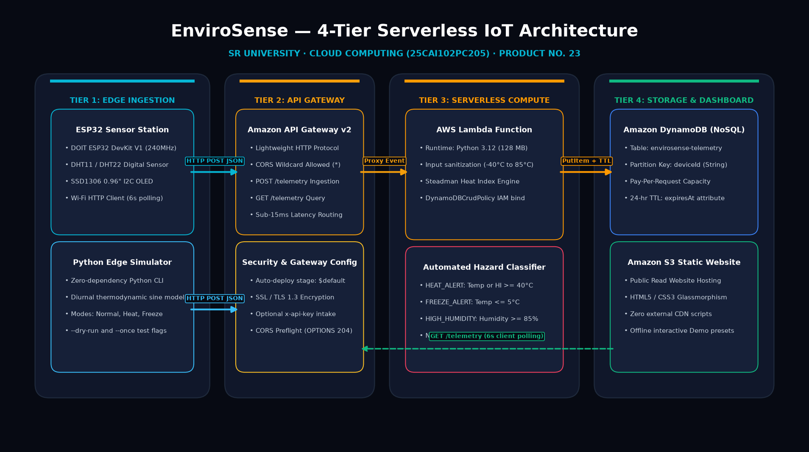
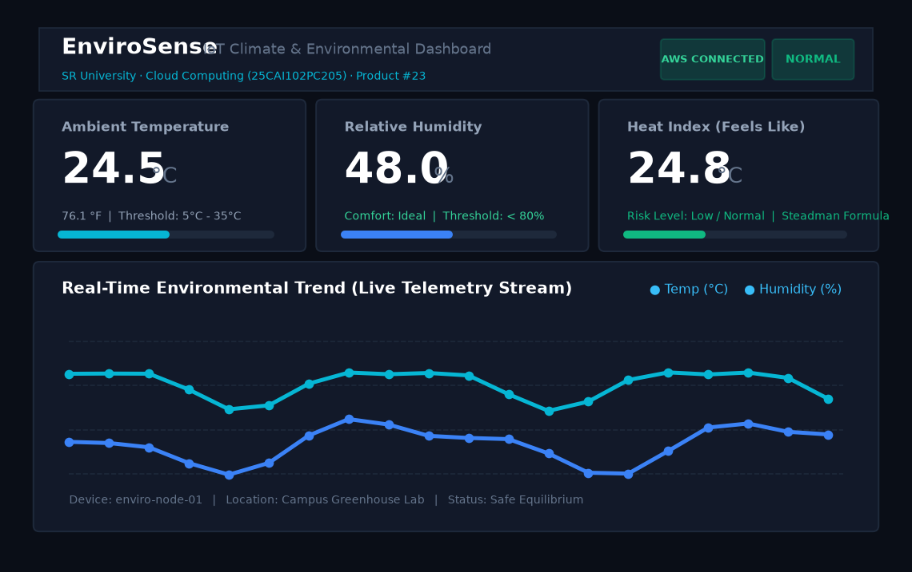
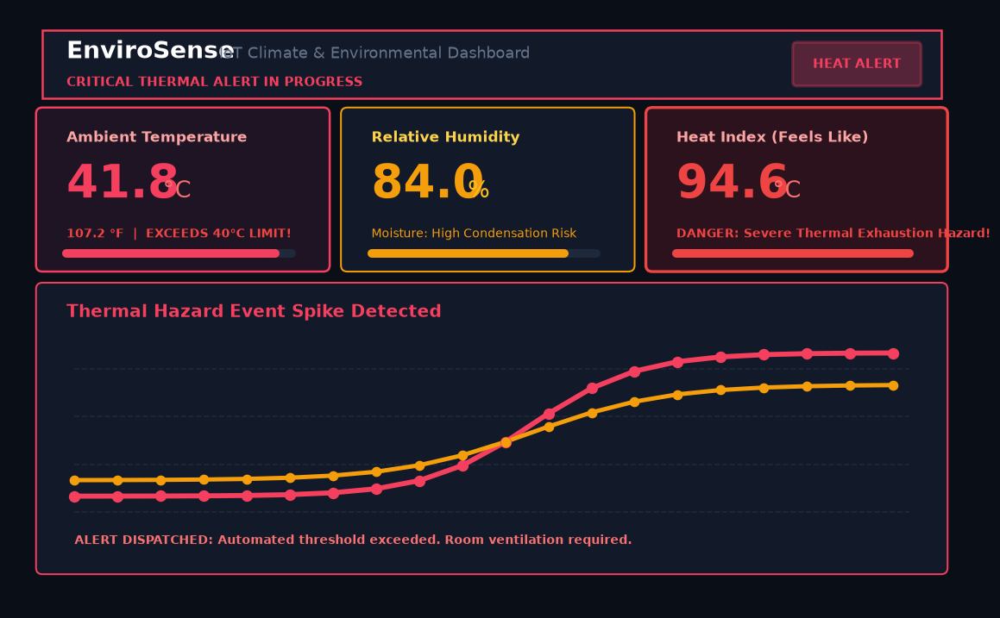
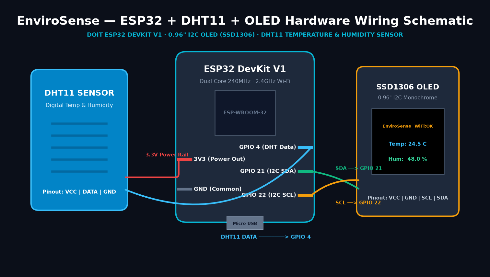
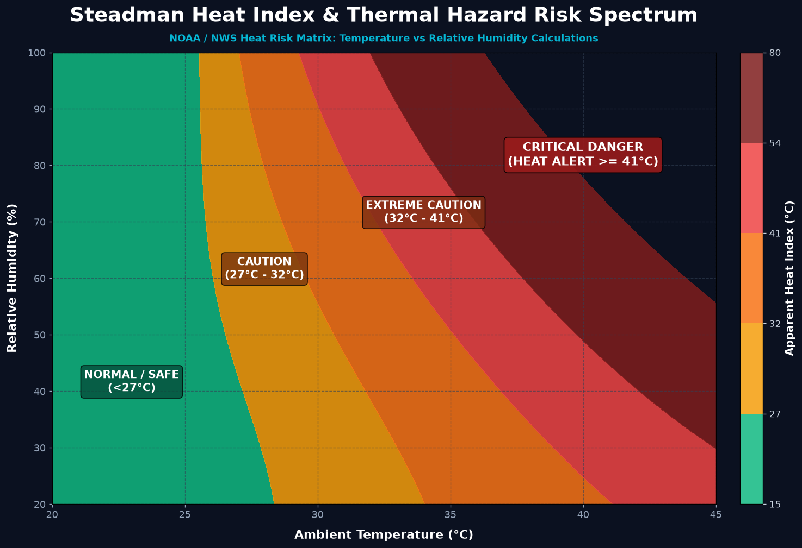
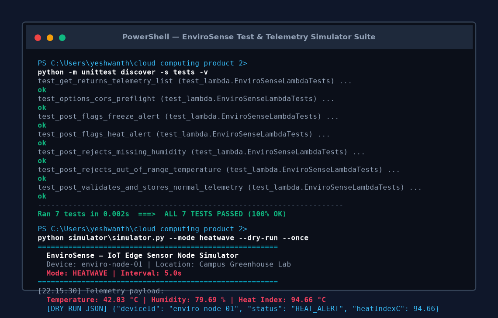

# EnviroSense — IoT Climate & Environmental Dashboard

[](https://aws.amazon.com/lambda/)
[](https://aws.amazon.com/dynamodb/)
[](https://aws.amazon.com/api-gateway/)
[](https://aws.amazon.com/s3/)
[](https://www.espressif.com/)
[](tests/)
[](docs/)

> **Course**: Cloud Computing (25CAI102PC205) · **Product #23** · **SR University**  
> **Team**: M. Yeshwanth (2503A53005) & V. Laxmiprasad (2503A53006) · Batch 59  
> **Environment**: AWS Learner Lab (`us-east-1`) with automated `LabRole` integration

---

## 📸 Visual Showcase & System Screenshots

### 1. 4-Tier Serverless Cloud Architecture


### 2. Live Glassmorphic S3 Dashboard — Operational Normal State


### 3. Live Dashboard — Critical Thermal Hazard State (Heat Alert)


### 4. Microcontroller Hardware Wiring & Circuit Schematic


### 5. NOAA / Steadman Apparent Heat Index Risk Spectrum


### 6. Terminal Test Suite (100% Pass) & Edge Simulator Execution


---

## Overview

**EnviroSense** is an end-to-end cloud-native IoT environmental monitoring system designed to track ambient temperature, relative humidity, and Steadman heat index in real time.

Field sensors (physical **ESP32 microcontroller** with DHT11/DHT22 and SSD1306 OLED, or cross-platform **Python software simulator**) stream telemetry to an **AWS HTTP API Gateway**. A serverless **AWS Lambda** function validates readings, computes thermal risk indices, triggers alert states (Heat Danger, Freeze Alert, Excessive Humidity), and persists time-series data into **Amazon DynamoDB** with automatic 24-hour Time-to-Live (TTL). The real-time glassmorphic dashboard is hosted as an **Amazon S3 static website**, complete with circular radial SVG dials, glowing area trendlines, Web Audio alerts, and a self-contained **offline Demo Mode** for presentations without active cloud connectivity.

---

## Repository Layout

```text
cloud computing product 2/
├── backend/
│   ├── app.py                 # Lambda handler for validation, heat index, and DynamoDB operations
│   └── requirements.txt       # Python runtime dependencies (boto3)
├── frontend/
│   ├── index.html             # S3-compatible static dashboard (circular dials, scenario cards)
│   ├── styles.css             # Glassmorphic dark-theme responsive design with ambient glows
│   └── app.js                 # API Gateway polling, SVG charting, audio alerts, and demo engine
├── firmware/
│   ├── esp32_dht11_oled.ino   # Production ESP32 Arduino C++ firmware (DHT11 + SSD1306 OLED)
│   └── wiring_schematic.md    # Circuit wiring schematic and hardware pinout table
├── simulator/
│   └── simulator.py           # Cross-platform Python edge sensor simulator with CLI flags
├── tests/
│   └── test_lambda.py         # Offline unit tests for Lambda contract and validation
├── docs/
│   ├── PRODUCT_REPORT.docx    # Formal submission report with embedded Figures 1 to 6
│   ├── PRODUCT_START_SHEET.docx # Official SR University course start sheet
│   └── screenshots/           # High-resolution architecture, schematic, and dashboard graphics
├── template.yaml              # AWS SAM infrastructure specification
├── samconfig.toml             # Preconfigured deployment settings (Learner Lab us-east-1)
├── cloudformation.yaml        # Pure CloudFormation stack with pre-configured LabRole
├── deploy.ps1                 # One-click PowerShell deployment & S3 sync script
├── EnviroSense_Master_Presentation.pptx # 16-slide master presentation with embedded diagrams
├── README.md                  # Comprehensive project documentation (this file)
└── REPORT.md                  # Academic submission report formatted to course guidelines
```

---

## Run the Dashboard Immediately (Zero-Setup Demo)

You can run and test the full dashboard right now on your local workstation without deploying to AWS:

1. Open `frontend/index.html` (or browse to [http://localhost:3000](http://localhost:3000) when running the local server).
2. It starts automatically in **Demo Mode**, displaying circular radial gauges, heat index calculations, and real-time SVG charts.
3. Test the interactive simulation scenario cards:
   - **🌿 Greenhouse Normal (24.5°C, 48%)**: Normal ambient climate with green status indicators.
   - **🔥 Heatwave Surge (41.8°C, 84%)**: Simulates severe heat danger; status changes to `HEAT ALERT` with audible buzzer.
   - **❄️ Cold Frost Drop (2.4°C, 32%)**: Simulates freezing conditions; status changes to `FREEZE ALERT`.
   - **🌧️ Tropical Rain (29.2°C, 92%)**: Simulates high condensation risks.
   - **▶️ Auto Live Stream**: Starts continuous simulated telemetry streaming with dynamic curve generation every 3 seconds.

---

## Deploy to AWS Learner Lab

### Prerequisites
- AWS CLI v2 (`aws --version`)
- Python 3.10+
- Active AWS Learner Lab credentials configured for `us-east-1` in `~/.aws/credentials`

### Option A: One-Click Automated Script (Recommended)
Open PowerShell in this directory and run:
```powershell
.\deploy.ps1
```
This script automatically:
1. Validates your AWS session.
2. Builds and deploys the CloudFormation / SAM stack (`envirosense`).
3. Automatically binds to the pre-existing Learner Lab `LabRole` (`arn:aws:iam::<account>:role/LabRole`) to avoid IAM creation restrictions.
4. Extracts the generated API Gateway URL and S3 bucket name.
5. Uploads all `frontend/` files to the S3 bucket with `aws s3 sync`.
6. Prints the public website URL.

### Option B: Pure CloudFormation Deploy
```powershell
aws cloudformation deploy `
  --template-file cloudformation.yaml `
  --stack-name envirosense `
  --parameter-overrides UseLabRole=true `
  --capabilities CAPABILITY_IAM `
  --region us-east-1
```

Once deployed, copy the `DashboardBucketName` and `EnviroApiUrl` from the outputs, and upload the frontend:
```bash
aws s3 sync frontend/ s3://YOUR_DASHBOARD_BUCKET_NAME --delete
```

Open the `DashboardWebsiteUrl` in your browser, paste the `EnviroApiUrl` into the API Gateway field, and click **Connect to AWS**.

---

## Microcontroller Hardware Setup (ESP32 + DHT11 + OLED)

If you have physical hardware:
1. Connect components according to [firmware/wiring_schematic.md](firmware/wiring_schematic.md) and Figure 4:
   - **DHT11 Data Pin** → `GPIO 4`
   - **OLED SDA** → `GPIO 21`
   - **OLED SCL** → `GPIO 22`
   - **Power Rails** → `3V3` and `GND`
2. Open `firmware/esp32_dht11_oled.ino` in Arduino IDE.
3. Update `WIFI_SSID`, `WIFI_PASSWORD`, and `API_URL`.
4. Upload the sketch. The OLED display will render real-time temperature, humidity, and transmit JSON to your cloud API every 6 seconds.

---

## Python Edge Simulator (Software Testing)

If you don't have physical hardware, use the included Python simulator:

```powershell
# Single test run (dry run without AWS)
python simulator\simulator.py --dry-run --once

# Stream simulated heatwave to live AWS API Gateway
python simulator\simulator.py --api-url "https://YOUR_API_ID.execute-api.us-east-1.amazonaws.com" --mode heatwave

# Realistic day/night diurnal temperature cycle
python simulator\simulator.py --api-url "https://YOUR_API_ID.execute-api.us-east-1.amazonaws.com" --mode fluctuate --interval 4
```

---

## Offline Verification & Unit Tests

Run the test suite offline without requiring an active AWS connection:
```powershell
python -m unittest discover -s tests -v
```

All 7 test cases verify:
- Ingestion and schema validation of temperature and humidity.
- Accurate calculation of Steadman Heat Index.
- Automated alert classification (`NORMAL`, `HEAT_ALERT`, `FREEZE_ALERT`, `HIGH_HUMIDITY`).
- Safe rejection of invalid inputs and out-of-bounds readings.
- HTTP CORS preflight compliance (`OPTIONS`).

---

## Expo & Presentation Walkthrough

When demonstrating to instructors or project evaluators:
1. **Show the S3 Dashboard**: Open `frontend/index.html` (or [http://localhost:3000](http://localhost:3000)). Point out the circular gauges, heat index risk evaluation, and native SVG trend chart.
2. **Demonstrate Threshold Alerting**: Click **🔥 Heatwave Surge (41.8°C)** — point out how the status pill turns pulsing red (`HEAT ALERT`), the risk evaluation updates to Critical Danger, and an audible warning tone sounds.
3. **Demonstrate Recovery**: Click **🌿 Greenhouse Normal (24.5°C)** — show how the system transitions smoothly back to `NORMAL` with a pleasant chime.
4. **Explain Cloud Architecture**: Point to Figure 1 and explain the decoupled, serverless flow:
   - S3 handles static web assets with zero server maintenance.
   - API Gateway provides low-latency HTTP ingestion.
   - Lambda validates and computes metrics on-demand without idle server costs.
   - DynamoDB stores time-series data with automated TTL pruning after 24 hours.
5. **Show Hardware / Edge Readiness**: Highlight `esp32_dht11_oled.ino` and `simulator.py` demonstrating edge-to-cloud integration.
