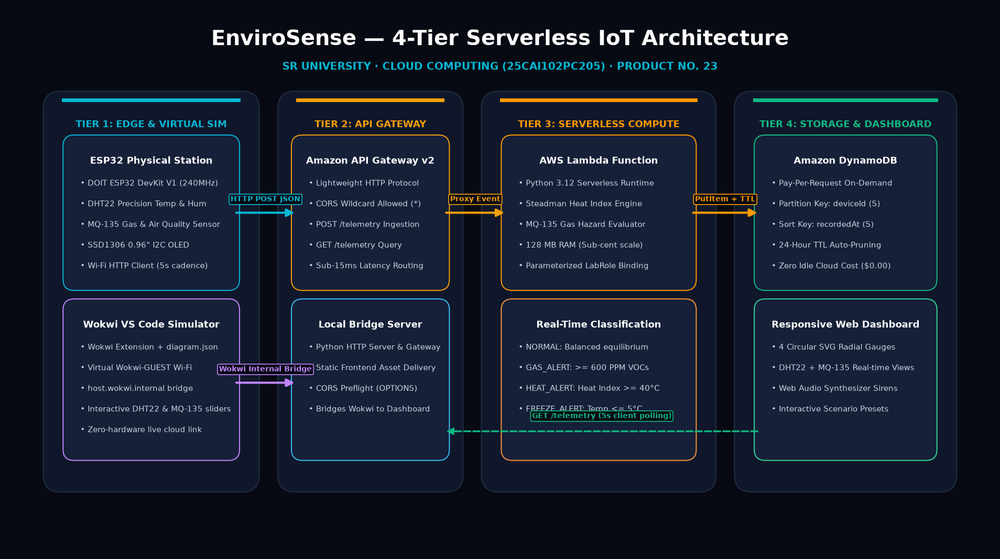
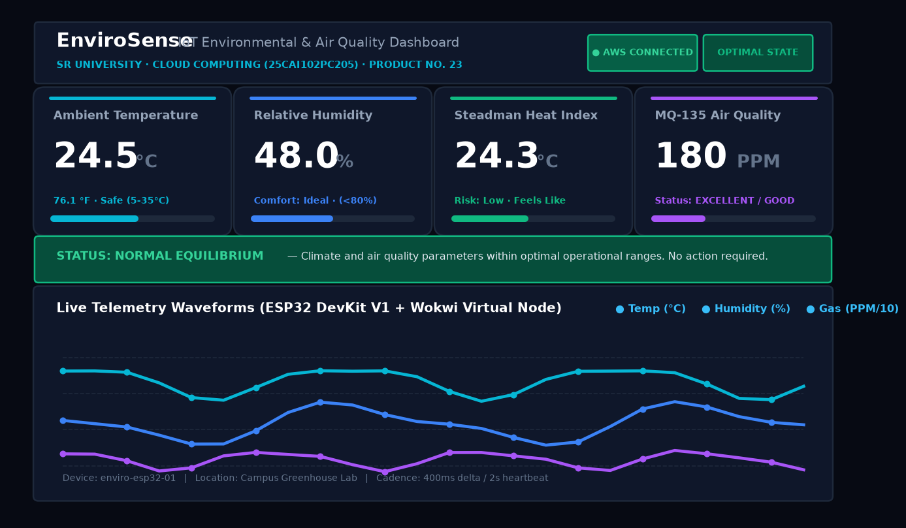
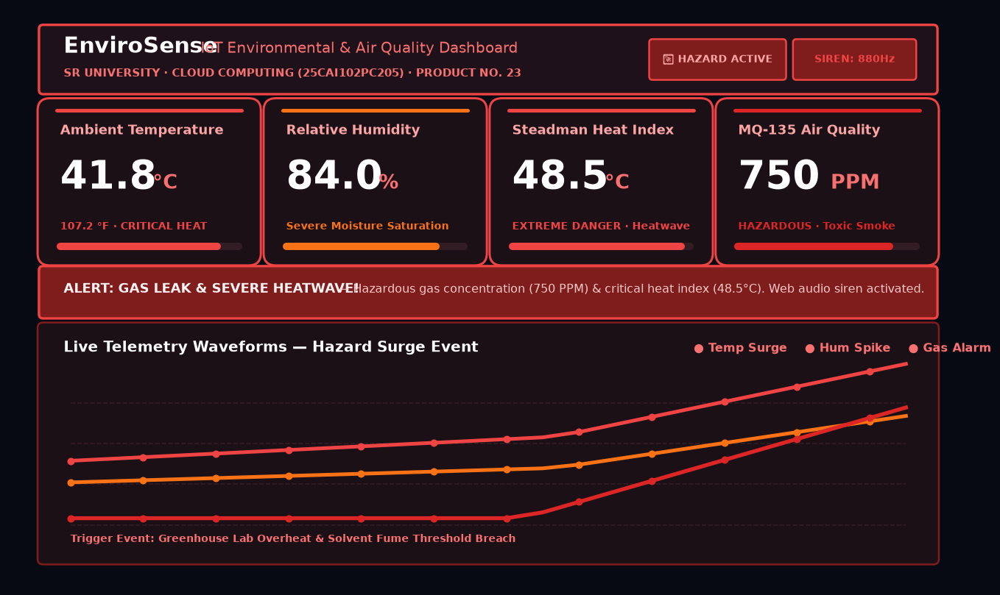
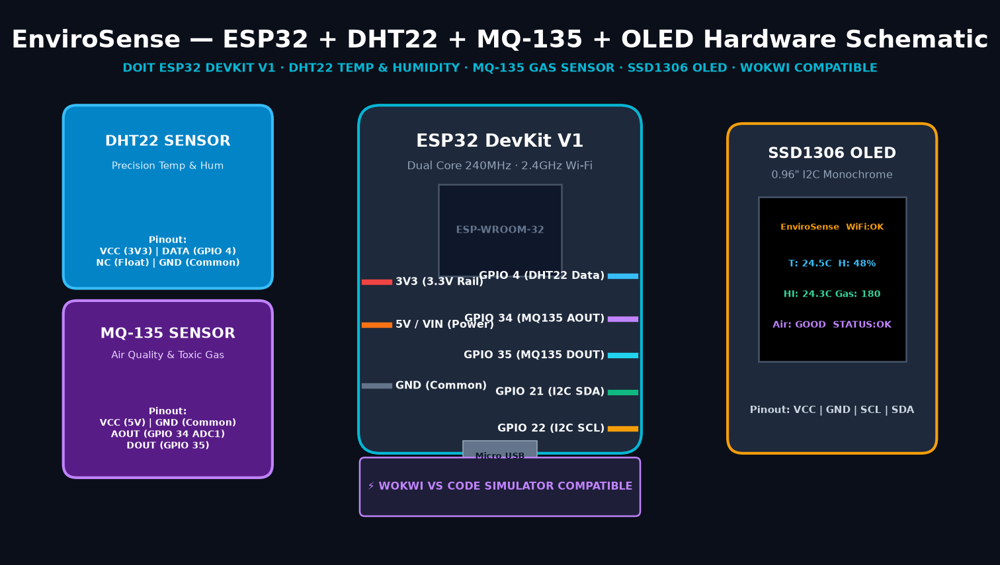
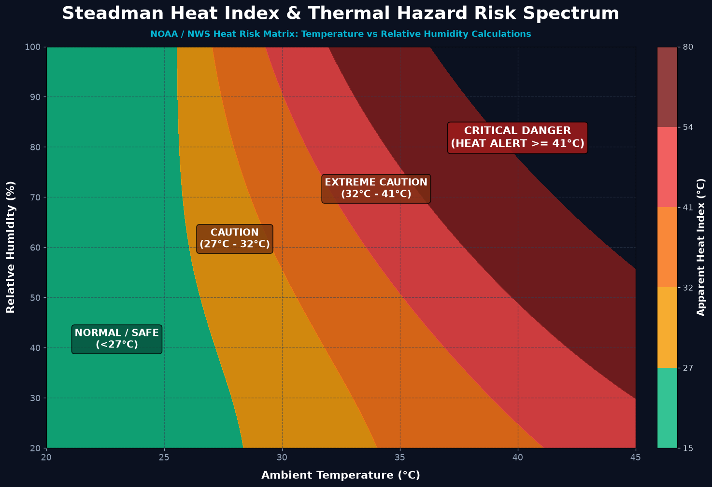
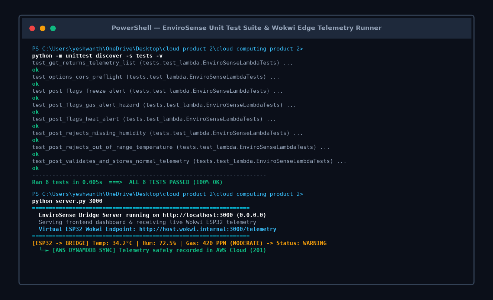

# EnviroSense — IoT Climate & Environmental Dashboard

[](https://aws.amazon.com/lambda/)
[](https://aws.amazon.com/dynamodb/)
[](https://aws.amazon.com/api-gateway/)
[](https://aws.amazon.com/s3/)
[](https://www.espressif.com/)
[](https://wokwi.com/)
[](tests/)
[](docs/)

> **Course**: Cloud Computing (25CAI102PC205) · **Product #23** · **SR University**  
> **Team**: M. Yeshwanth (2503A53005) & V. Laxmiprasad (2503A53006) · Batch 59  
> **Environment**: AWS Learner Lab (`us-east-1`) with automated `LabRole` integration

---

## 📸 Visual Showcase & System Screenshots

### 1. 4-Tier Serverless Cloud & Virtual Simulator Architecture


### 2. Live Glassmorphic Dashboard — Operational Normal State


### 3. Live Dashboard — Critical Thermal Hazard State (Heat Alert)


### 4. ESP32 + DHT22 + MQ-135 + OLED Hardware Circuit Schematic & Pinout


### 5. NOAA / Steadman Apparent Heat Index Risk Spectrum


### 6. Terminal Test Suite (100% Pass) & Edge Simulator Execution


---

## Overview

**EnviroSense** is an end-to-end cloud-native IoT environmental & air quality monitoring system designed to track ambient temperature, relative humidity, Steadman heat index, and toxic gas/air quality (PPM) in real time.

Field sensing is powered by an **ESP32 microcontroller** wired to:
- **DHT22**: High-precision temperature (-40°C to 80°C) and relative humidity (0% to 100%) sensor.
- **MQ-135**: Electrochemical air quality and hazardous gas sensor (CO2, ammonia, benzene, smoke, NOx).
- **SSD1306 OLED**: 0.96" graphical display showing local real-time metrics and network status.

The system natively supports **Wokwi for VS Code** virtual simulation, allowing developers to simulate the full microcontroller circuit inside VS Code and stream live telemetry directly to the local dashboard or AWS cloud without physical hardware!

---

## 🌐 Live Deployed AWS Cloud Infrastructure

The complete serverless stack is deployed and operational in **AWS Learner Lab (`us-east-1`)**:

| Component | AWS Resource | Live Endpoint / Value |
| :--- | :--- | :--- |
| **Frontend Dashboard** | Amazon S3 Static Website | [http://envirosense-dashboard-683495019184.s3-website-us-east-1.amazonaws.com](http://envirosense-dashboard-683495019184.s3-website-us-east-1.amazonaws.com) |
| **Ingestion API** | Amazon API Gateway HTTP API (v2) | `https://etejnaemlc.execute-api.us-east-1.amazonaws.com/telemetry` |
| **Serverless Compute** | AWS Lambda | `envirosense-handler` (Python 3.12, LabRole execution) |
| **Database** | Amazon DynamoDB | `envirosense-telemetry` (TTL enabled, On-Demand) |
| **Storage Bucket** | Amazon S3 | `s3://envirosense-dashboard-683495019184` |
| **AWS Region** | US East (N. Virginia) | `us-east-1` (Account: `683495019184`) |

---

## ⚡ Virtual ESP32 Simulation in VS Code (Wokwi)

You can run the simulated ESP32 node and connect it to your project dashboard with zero physical hardware:

### Prerequisites:
- **VS Code** with the **Wokwi for VS Code** extension installed (`wokwi.wokwi-vscode`).
- **PlatformIO IDE** extension or PlatformIO Core (`pio`).

### 3-Step Quick Start:
1. **Start the Local Bridge Server**:
   ```powershell
   python server.py 3000
   ```
   *Serves the web dashboard at `http://localhost:3000` and creates the Wokwi bridge at `http://host.wokwi.internal:3000/telemetry`.*

2. **Open the Virtual Circuit in VS Code**:
   - In VS Code, open the file `diagram.json`.
   - Press **F1** (or `Ctrl+Shift+P`), type and select:
     ```text
     Wokwi: Start Simulator
     ```
   - Alternatively, click the green **Play** button inside the Wokwi tab.

3. **Interact in Real Time**:
   - The virtual **ESP32 DevKit V1** boots up, connects to virtual Wi-Fi (`Wokwi-GUEST`), and renders on the virtual **SSD1306 OLED** screen.
   - Click the **DHT22** sensor to drag temperature & humidity sliders.
   - Click the **MQ-135** gas sensor to slide the gas concentration level.
   - Watch the virtual ESP32 transmit telemetry via HTTP POST.
   - Open your browser to [http://localhost:3000](http://localhost:3000): The dashboard circular radial gauges, gas indicator, and live waveforms animate immediately with data from the virtual ESP32!

---

## Repository Layout

```text
cloud computing product 2/
├── backend/
│   ├── app.py                 # Lambda handler for validation, heat index, gas evaluation & DynamoDB
│   └── requirements.txt       # Python runtime dependencies (boto3)
├── frontend/
│   ├── index.html             # S3-compatible static dashboard (4 circular SVG dials, scenario presets)
│   ├── styles.css             # Glassmorphic dark-theme responsive design with ambient glows
│   └── app.js                 # Live bridge polling, SVG charting, audio alerts, and demo engine
├── firmware/
│   ├── src/main.cpp           # PlatformIO C++ firmware with dual Wokwi & hardware WiFi modes
│   ├── esp32_dht22_mq135_oled.ino # Standalone Arduino IDE firmware sketch
│   └── wiring_schematic.md    # Circuit wiring schematic, hardware pinouts, and simulation guide
├── simulator/
│   └── simulator.py           # Python edge sensor simulator with --mode normal|heatwave|freeze|gasleak
├── tests/
│   └── test_lambda.py         # Automated unit tests for Lambda contracts, validation & gas alerts (8/8 PASS)
├── docs/
│   ├── PRODUCT_REPORT.docx    # Formal submission report with embedded Figures 1 to 6
│   ├── PRODUCT_START_SHEET.docx # Official SR University course start sheet
│   └── screenshots/           # High-resolution architecture, schematic, and dashboard graphics (Figures 1-6)
├── diagram.json               # Wokwi virtual circuit (ESP32 + DHT22 + MQ-135 + SSD1306 OLED)
├── wokwi.toml                 # Wokwi simulator configuration pointing to compiled .bin / .elf
├── platformio.ini             # PlatformIO build configuration for espressif32
├── server.py                  # Local Python bridge server (frontend + /telemetry endpoint + AWS cloud relay)
├── template.yaml              # AWS SAM infrastructure specification
├── samconfig.toml             # Preconfigured deployment settings (Learner Lab us-east-1)
├── cloudformation.yaml        # Pure CloudFormation stack with pre-configured LabRole
├── deploy.ps1                 # One-click PowerShell deployment & S3 sync script
├── generate_rich_assets.py    # Matplotlib generator for all 6 ultra-high-resolution figures
├── generate_presentation.py   # Python-pptx builder for 16-slide master presentation
├── generate_docs.py           # Python-docx builder for Word report & start sheet
├── EnviroSense_Master_Presentation.pptx # 16-slide master presentation with embedded diagrams
├── README.md                  # Comprehensive project documentation (this file)
└── REPORT.md                  # Academic submission report formatted to course guidelines
```

---

## Run the Dashboard (Local Workstation)

1. Run the local server:
   ```powershell
   python server.py 3000
   ```
2. Open [http://localhost:3000](http://localhost:3000) in your web browser.
3. Test the interactive simulation scenario presets:
   - **🌿 Greenhouse Normal (24.5°C, 48% RH, 180 PPM)**: Optimal climate with green status indicators.
   - **🔥 Heatwave Surge (41.8°C, 84% RH)**: Severe heatwave; triggers `HEAT ALERT` and audio tone.
   - **❄️ Cold Frost Drop (2.4°C, 32% RH)**: Freezing frost risk; triggers `FREEZE ALERT`.
   - **🌧️ Tropical Rain (29.2°C, 92% RH)**: High humidity condensation risk.
   - **☣️ Gas Leak Hazard (MQ-135: 750 PPM)**: Toxic gas / smoke detection; triggers `GAS ALERT` siren.
   - **▶️ Auto Live Stream**: Continuous real-time stream ticking every 3 seconds.

---

## Deploy to AWS Learner Lab

### Prerequisites:
- AWS CLI v2 (`aws --version`)
- Active AWS Learner Lab credentials configured for `us-east-1` in `~/.aws/credentials`

### One-Click Automated Script:
```powershell
.\deploy.ps1
```
This script automatically:
1. Validates your AWS session.
2. Builds and deploys the CloudFormation / SAM stack (`envirosense`).
3. Automatically binds to the pre-existing Learner Lab `LabRole` (`arn:aws:iam::<account>:role/LabRole`).
4. Extracts the generated API Gateway URL and S3 bucket name.
5. Uploads all `frontend/` files to the S3 bucket with `aws s3 sync`.
6. Prints the public website URL.

---

## Physical Hardware Pin Connections

| Sensor / Module | Sensor Pin | ESP32 Pin | Purpose |
| :--- | :--- | :--- | :--- |
| **DHT22** | DATA | `GPIO 4` | Digital Temperature & Humidity |
| **DHT22** | VCC / GND | `3V3` / `GND` | Power & Common Ground |
| **MQ-135** | AOUT | `GPIO 34` | Analog Gas Level (**ADC1 - Wi-Fi safe**) |
| **MQ-135** | VCC / GND | `5V` (or `3V3`) / `GND` | Heater & Sensor Power |
| **SSD1306 OLED** | SDA | `GPIO 21` | Hardware I2C Data |
| **SSD1306 OLED** | SCL | `GPIO 22` | Hardware I2C Clock |
| **SSD1306 OLED** | VCC / GND | `3V3` / `GND` | 3.3V Power & Ground |
