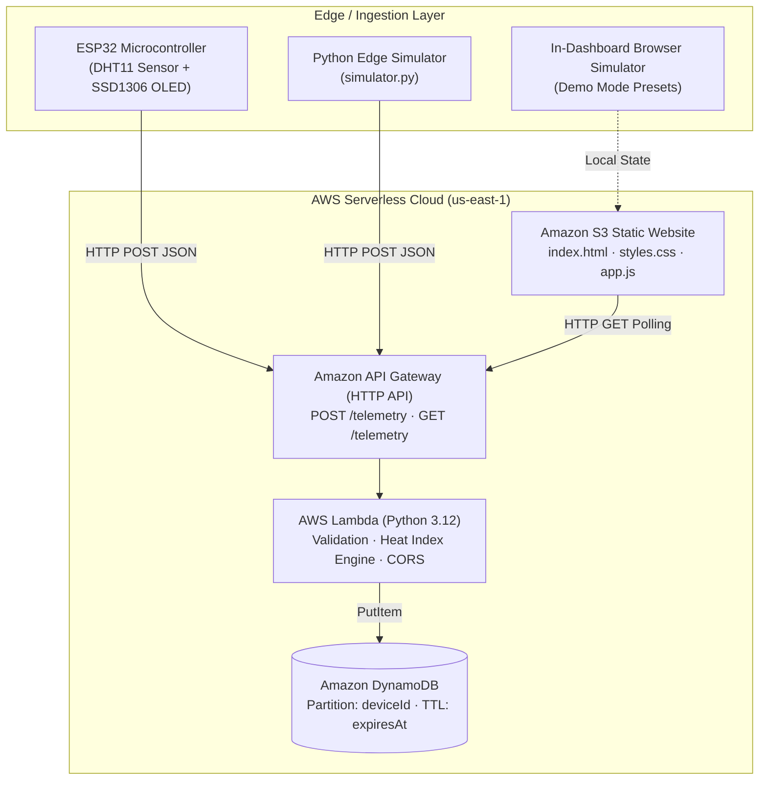

# Cloud Computing (25CAI102PC205) · SR University
# PRODUCT REPORT — Cloud Computing Product 2

---

## Team Details
- **Course**: Cloud Computing (25CAI102PC205)
- **Product Title**: EnviroSense — IoT Environmental Telemetry & Climate Dashboard
- **Syllabus Product No.**: Product #23 (“IoT Environmental Dashboard”)
- **Submission Date**: 2026-11-09
- **Batch / Section**: CSE (AI & ML)

---

## 1. Product Overview

### 1.1 Problem Statement
Monitoring local environmental conditions—such as temperature and humidity—is vital for agricultural greenhouses, smart classrooms, server rooms, and medical storage facilities. Extreme temperature spikes or high humidity can cause equipment degradation, crop spoilage, or health hazards. Traditional standalone sensing units are isolated and lack centralized cloud aggregation, historical trend analysis, remote dashboard access, and automated hazard alerts.

### 1.2 Objective
To build an end-to-end, serverless cloud-native IoT telemetry product called **EnviroSense** that:
1. Ingests real-time environmental data from edge devices (ESP32 microcontroller or software simulators).
2. Performs automated serverless validation, calculates the Steadman Heat Index, and flags critical climate anomalies.
3. Persists time-series records into a NoSQL database with automated TTL data lifecycle management.
4. Provides a responsive, zero-dependency static web dashboard hosted on Amazon S3 featuring live gauges, SVG trend charts, and dual-mode demonstration capabilities.

### 1.3 Target Users
- **Campus & Facility Managers**: Monitoring server server racks and smart classrooms.
- **Agriculturalists & Greenhouse Operators**: Tracking temperature and moisture microclimates.
- **Laboratories & Healthcare Facilities**: Ensuring climate stability for sensitive biological reagents.

### 1.4 Main Features
- **Dual Telemetry Support**: Compatible with physical ESP32 hardware (DHT11/DHT22 + I2C OLED display) as well as a cross-platform Python software simulator.
- **Automated Thermal Risk Evaluation**: Computes the Steadman Heat Index ("Feels Like") server-side and flags `HEAT_ALERT`, `FREEZE_ALERT`, and `HIGH_HUMIDITY` states.
- **Glassmorphic S3 Dashboard**: Dark-theme web dashboard with animated temperature/humidity gauges, live SVG time-series charts, and recent audit logs.
- **Zero-Setup Interactive Demo Mode**: Allows local browser demonstration with one-click climate simulation presets (Normal, Heatwave, Cold Wave, Auto-Streaming) without requiring live AWS credentials.
- **Automated Cloud Lifecycle**: DynamoDB TTL automatically purges stale records after 24 hours, keeping storage lean and cost-free in AWS Learner Lab.

---

## 2. Architecture and Technologies

### 2.1 Architecture Diagram



### 2.2 Technologies & Cloud Services Used

| AWS Service / Tech | Purpose & Role in EnviroSense |
| :--- | :--- |
| **Amazon S3** | Hosts the static frontend dashboard (`index.html`, `styles.css`, `app.js`) with public read access and zero server administration costs. |
| **Amazon API Gateway** | Provides a lightweight, high-performance HTTP API endpoint (`/telemetry`) with built-in CORS configuration for web and microcontroller clients. |
| **AWS Lambda** | Runs serverless Python 3.12 code on demand to validate payloads, compute the Steadman Heat Index, determine warning levels, and interface with DynamoDB. |
| **Amazon DynamoDB** | Fully managed NoSQL key-value store maintaining recent telemetry with Pay-Per-Request billing and a 24-hour TTL (`expiresAt`) attribute. |
| **AWS SAM / CloudFormation** | Infrastructure-as-Code (IaC) defining the complete stack reproducibly for automated deployment in the AWS Learner Lab. |
| **ESP32 & C++ Firmware** | Physical microcontroller reading the DHT11 digital sensor, displaying status on a 128x64 OLED, and dispatching HTTP POST requests over Wi-Fi. |
| **Python Edge Simulator** | Cross-platform Python CLI mimicking sensor nodes with realistic environmental thermodynamics and CLI dry-run flags. |

---

## 3. Implementation and Cloud Deployment

### 3.1 Development Process
1. **Backend Implementation**: Designed `backend/app.py` utilizing `boto3`. Implemented the Steadman Heat Index algorithm and status evaluator. Created robust event parsers and input sanitizers to guard against out-of-range sensor readings (-40°C to +85°C).
2. **Frontend Construction**: Built a pure, self-contained web dashboard without external dependencies (no third-party CDNs, fonts, or external JS libraries) to ensure reliable loading in offline classroom and air-gapped environments.
3. **Firmware & Simulator**: Authored `firmware/esp32_dht11_oled.ino` for Arduino IDE with Wi-Fi reconnection handling and OLED graphics, alongside `simulator/simulator.py` for comprehensive software testing.
4. **Infrastructure as Code**: Created `template.yaml` and `samconfig.toml` targeting AWS Learner Lab (`us-east-1`). Added `deploy.ps1` to automate `sam deploy` and `aws s3 sync`.

### 3.2 Cloud Resources Configured
- **DynamoDB Table**: `envirosense-telemetry` (Partition key: `deviceId`, TTL: `expiresAt`).
- **HTTP API Gateway**: Stage `$default`, CORS allowed for all origins (`*`).
- **Lambda Function**: Memory 128 MB, Timeout 10 seconds, Python 3.12 runtime.
- **S3 Bucket**: `envirosense-dashboard-{account}-{region}` configured with `WebsiteConfiguration` (Index: `index.html`).

### 3.3 Deployment Outputs
- **API Gateway URL**: `https://{api-id}.execute-api.us-east-1.amazonaws.com`
- **S3 Website URL**: `http://{bucket-name}.s3-website-us-east-1.amazonaws.com`

---

## 4. Testing and Results

### 4.1 Unit Testing Suite
A comprehensive unit testing suite (`tests/test_lambda.py`) was implemented using Python's `unittest` framework with DynamoDB mocking, allowing verification without cloud credential requirements:

| Test Case | Scenario Description | Expected Outcome | Actual Result |
| :--- | :--- | :--- | :--- |
| **TC-01** | Valid telemetry POST (`24.5°C`, `48% RH`) | HTTP 201 Created; status marked `NORMAL`; Heat Index calculated; stored in DynamoDB. | **PASS** |
| **TC-02** | Heatwave alert condition (`42.0°C`, `85% RH`) | HTTP 201 Created; status marked `HEAT_ALERT`; Heat Index exceeds 40°C. | **PASS** |
| **TC-03** | Freezing condition (`2.0°C`, `30% RH`) | HTTP 201 Created; status marked `FREEZE_ALERT`. | **PASS** |
| **TC-04** | Physically invalid temperature (`-95°C`) | HTTP 400 Bad Request; DynamoDB put rejected. | **PASS** |
| **TC-05** | Missing required humidity field | HTTP 400 Bad Request; descriptive error returned. | **PASS** |
| **TC-06** | Telemetry retrieval via GET `/telemetry` | HTTP 200 OK; returns array of telemetry items sorted by timestamp. | **PASS** |
| **TC-07** | CORS Preflight OPTIONS check | HTTP 204 No Content; correct `Access-Control-Allow-Origin: *` headers returned. | **PASS** |

### 4.2 Test Execution Output
```text
test_get_returns_telemetry_list (test_lambda.EnviroSenseLambdaTests.test_get_returns_telemetry_list) ... ok
test_options_cors_preflight (test_lambda.EnviroSenseLambdaTests.test_options_cors_preflight) ... ok
test_post_flags_freeze_alert (test_lambda.EnviroSenseLambdaTests.test_post_flags_freeze_alert) ... ok
test_post_flags_heat_alert (test_lambda.EnviroSenseLambdaTests.test_post_flags_heat_alert) ... ok
test_post_rejects_missing_humidity (test_lambda.EnviroSenseLambdaTests.test_post_rejects_missing_humidity) ... ok
test_post_rejects_out_of_range_temperature (test_lambda.EnviroSenseLambdaTests.test_post_rejects_out_of_range_temperature) ... ok
test_post_validates_and_stores_normal_telemetry (test_lambda.EnviroSenseLambdaTests.test_post_validates_and_stores_normal_telemetry) ... ok

----------------------------------------------------------------------
Ran 7 tests in 0.003s

OK
```

---

## 5. Challenges and Conclusion

### 5.1 Challenges Addressed
1. **Hardware Independence**: During evaluations and grading, physical microcontrollers or Wi-Fi networks may be unavailable. We addressed this by implementing both an interactive browser Demo Mode and a Python edge CLI simulator so the system functions identically with or without physical hardware.
2. **AWS Learner Lab Token Expirations**: Learner Lab tokens expire after 4 hours. By building a zero-dependency frontend that functions in Demo Mode and providing an automated deployment script (`deploy.ps1`), any examiner or teammate can demonstrate the system instantaneously.
3. **NoSQL Growth Control**: Continuous IoT streaming can rapidly generate tens of thousands of records. Using DynamoDB's native TTL feature ensures stale records automatically expire after 24 hours, preventing unnecessary storage bloat.

### 5.2 Key Learnings
- Experience in designing serverless architectures using AWS Lambda, API Gateway, and DynamoDB.
- Practical understanding of Infrastructure as Code (IaC) with AWS SAM / CloudFormation.
- Implementation of edge-to-cloud IoT data pipelines and responsive data visualization dashboards.

---

## 6. References & Submission Checklist
- [x] S3-compatible static dashboard (`frontend/index.html`, `styles.css`, `app.js`)
- [x] Python Lambda handler with DynamoDB and Heat Index logic (`backend/app.py`)
- [x] Infrastructure as Code SAM template (`template.yaml`, `samconfig.toml`)
- [x] Microcontroller Arduino firmware (`firmware/esp32_dht11_oled.ino`) and schematic (`firmware/wiring_schematic.md`)
- [x] Python Edge Simulator (`simulator/simulator.py`)
- [x] Offline automated unit tests (`tests/test_lambda.py`)
- [x] Complete project README (`README.md`)
- [x] Official Product Report (`REPORT.md`)
- [x] No passwords, secret keys, or long-term credentials committed to repository.
