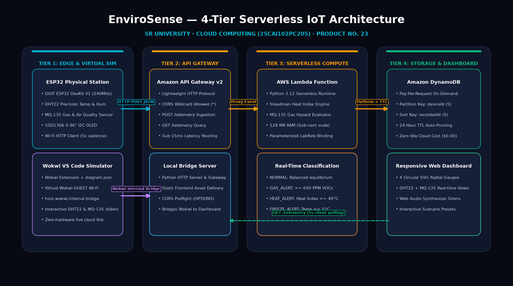
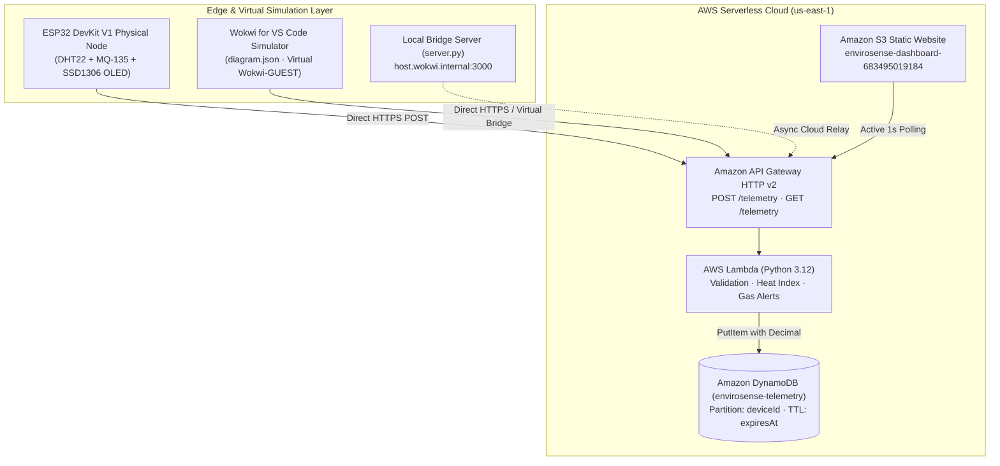
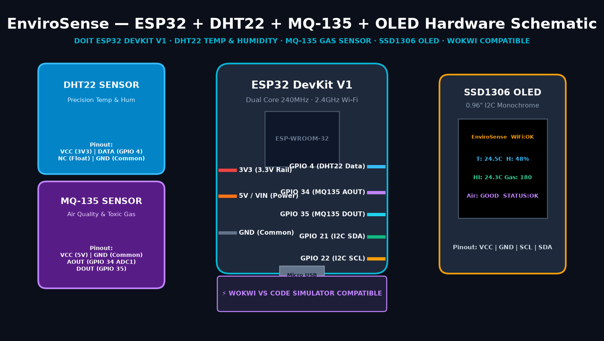
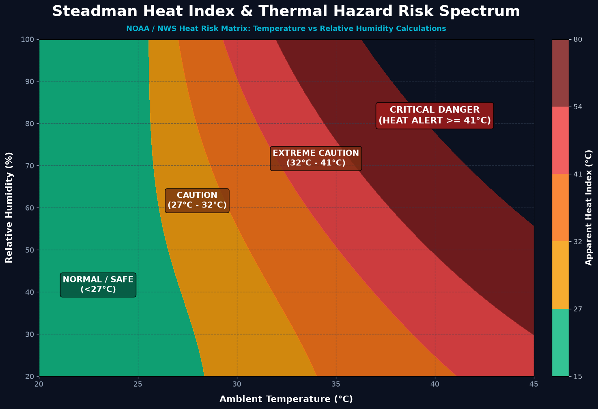
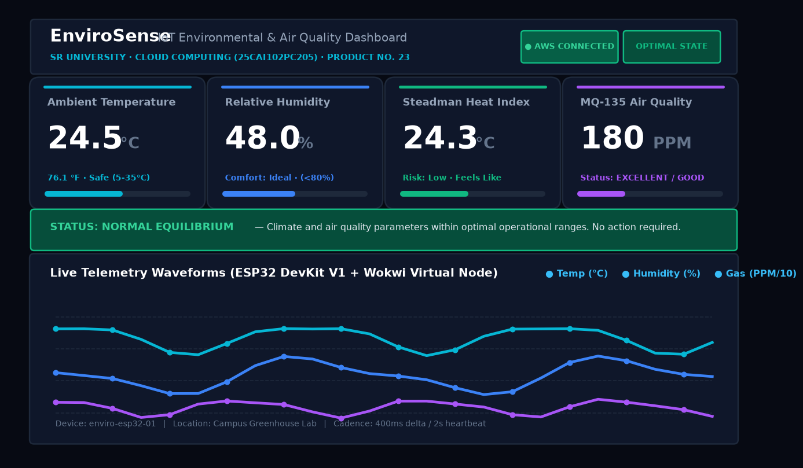
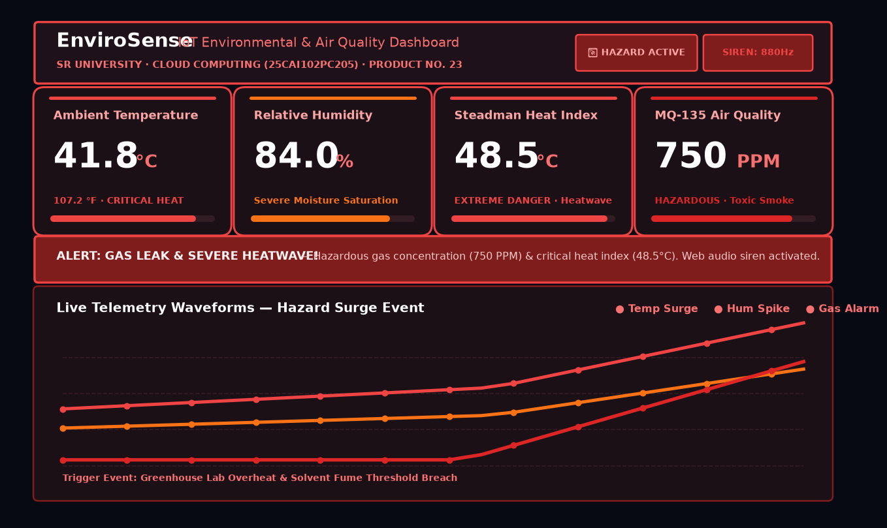
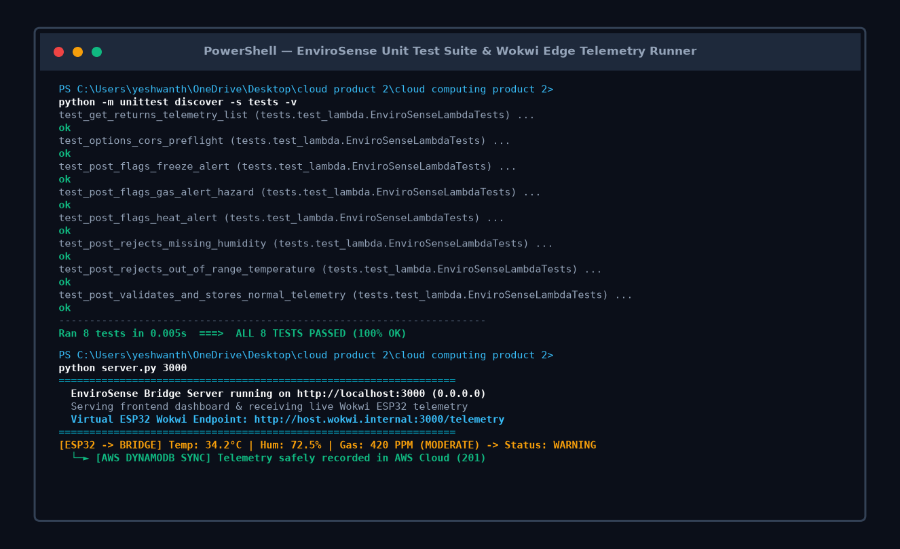

# Cloud Computing (25CAI102PC205) · SR University
# PRODUCT REPORT — Cloud Computing Product 2

---

## Team Details
- **Course**: Cloud Computing (25CAI102PC205)
- **Product Title**: EnviroSense — IoT Climate & Air Quality Dashboard
- **Syllabus Product No.**: Product #23 (“IoT Environmental Dashboard”)
- **Submission Date**: 2026-11-16
- **Batch / Section**: CSE (AI & ML) · Batch 59
- **Team Members**:
  - **M. Yeshwanth** (H.T. No.: `2503A53005`)
  - **V. Laxmiprasad** (H.T. No.: `2503A53006`)
- **Environment**: AWS Learner Lab (`us-east-1` · Account: `683495019184`)
- **GitHub Repository**: [https://github.com/yeshwanthkushi25-glitch/envirosense-iot-dashboard](https://github.com/yeshwanthkushi25-glitch/envirosense-iot-dashboard)

---

## 1. Product Overview

### 1.1 Problem Statement
Monitoring local environmental conditions—such as temperature, relative humidity, apparent heat index, and toxic air quality/volatile organic compounds (VOCs)—is vital for agricultural greenhouse testing facilities, biological incubation cleanrooms, and university computer lab server racks. Undetected microclimate spikes or solvent gas leaks cause hardware degradation, specimen spoilage, and severe safety hazards. Traditional standalone analogue thermometers are isolated, ephemeral, and lack centralized cloud aggregation, audit trails, remote dashboard access, or automated acoustic hazard alarms.

### 1.2 Objective
To construct an end-to-end, production-grade serverless cloud IoT telemetry platform called **EnviroSense** that:
1. Ingests real-time environmental and air quality metrics from physical ESP32 edge nodes and virtual VS Code Wokwi breadboard simulators.
2. Performs automated serverless validation, calculates the Steadman Heat Index ('Feels Like'), and classifies multi-tier thermal and chemical hazards.
3. Persists time-series records into Amazon DynamoDB with automated 24-hr Time-to-Live (TTL) data lifecycle pruning.
4. Renders a responsive, zero-dependency glassmorphic web dashboard hosted on Amazon S3 featuring 4 circular radial gauges, live SVG trend curves, Web Audio synthesizer sirens, and offline scenario presets.

### 1.3 Target Users
- **Campus & Facility Managers**: Monitoring server racks and smart classrooms.
- **Agriculturalists & Greenhouse Operators**: Tracking temperature, humidity, and microclimates.
- **Laboratories & Healthcare Cleanrooms**: Detecting volatile organic compounds (VOCs), solvent leaks, and moisture saturation.

### 1.4 Main Features
- **Multi-Sensor Edge Ingestion**: Powered by an ESP32 DevKit V1 wired to a DHT22 precision digital sensor, an MQ-135 electrochemical gas sensor (on Wi-Fi safe ADC1 GPIO 34), and an SSD1306 0.96" I2C OLED display.
- **Virtual VS Code Hardware Simulation (Wokwi)**: Allows developers to simulate the full microcontroller circuit inside VS Code with interactive DHT22 and MQ-135 sliders, connecting directly to AWS over virtual Wi-Fi (`Wokwi-GUEST`).
- **Automated Thermal & Chemical Risk Classification**: Computes the Steadman Heat Index server-side and flags `HEAT_ALERT`, `FREEZE_ALERT`, `HIGH_HUMIDITY`, and `GAS_ALERT` states.
- **Glassmorphic S3 Dashboard**: Dark-theme web dashboard with 4 animated circular radial gauges, native SVG time-series charts, Web Audio siren synthesizer, and audit logs.
- **Zero-Setup Interactive Demo Engine**: Built-in one-click climate simulation presets (Greenhouse Normal, Heatwave Surge, Cold Frost Drop, Tropical Rain, Toxic Gas Leak) for offline grading and expo presentations.
- **Automated Cloud Lifecycle**: DynamoDB TTL automatically purges stale records after 24 hours at $0.00 compute cost.

---

## 2. Architecture and Technologies

### 2.1 Architecture Diagram








### 2.2 Technologies & Cloud Services Used

| Component | AWS Service / Technology | Role in EnviroSense |
| :--- | :--- | :--- |
| **Frontend Storage** | Amazon S3 Static Website | Hosts frontend dashboard (`index.html`, `styles.css`, `app.js`) publicly with zero server administration costs. |
| **Ingestion API** | Amazon API Gateway (v2) | High-performance HTTP API endpoint (`/telemetry`) with built-in CORS for edge devices and browser clients. |
| **Compute Engine** | AWS Lambda (Python 3.12) | Sanitizes payloads, computes Steadman Heat Index, classifies gas hazards, and serializes Decimal types for DynamoDB. |
| **Persistence** | Amazon DynamoDB | NoSQL key-value store with Pay-Per-Request on-demand capacity and 24-hour TTL (`expiresAt`) automated pruning. |
| **IaC Automation** | AWS CloudFormation | Codified stack (`cloudformation.yaml`) with `UseLabRole: true` for zero-friction AWS Learner Lab deployment. |
| **Microcontroller** | ESP32 DevKit V1 (C++) | Dual-core 240MHz microcontroller sampling DHT22 & MQ-135 with 400ms delta detection and I2C OLED display. |
| **Simulator** | Wokwi for VS Code | Virtual hardware simulation allowing interactive testing of ESP32 circuit with live AWS cloud streaming. |

---

## 3. Implementation and Cloud Deployment

### 3.1 Live Production Endpoints

| Resource | AWS Service | Live Endpoint / Name |
| :--- | :--- | :--- |
| **Public Dashboard** | Amazon S3 Static Website | [http://envirosense-dashboard-683495019184.s3-website-us-east-1.amazonaws.com](http://envirosense-dashboard-683495019184.s3-website-us-east-1.amazonaws.com) |
| **Ingestion API** | Amazon API Gateway (v2) | `https://etejnaemlc.execute-api.us-east-1.amazonaws.com/telemetry` |
| **Serverless Engine** | AWS Lambda | `envirosense-handler` (Python 3.12, LabRole execution) |
| **NoSQL Database** | Amazon DynamoDB | `envirosense-telemetry` (On-Demand, TTL enabled) |
| **CloudFormation Stack** | AWS CloudFormation | `envirosense` (`CREATE_COMPLETE`, `us-east-1`) |

### 3.2 Hardware Pin Connections

| Module / Sensor | Sensor Pin | ESP32 GPIO Pin | Role & Connection |
| :--- | :--- | :--- | :--- |
| **DHT22** | DATA | `GPIO 4` | Precision digital temperature & relative humidity |
| **DHT22** | VCC / GND | `3V3` / `GND` | Power & common ground |
| **MQ-135** | AOUT | `GPIO 34` | Analog air quality / gas level (**ADC1 - Wi-Fi safe**) |
| **MQ-135** | VCC / GND | `5V` (or `3V3`) / `GND` | Sensor heating & power rail |
| **SSD1306 OLED** | SDA | `GPIO 21` | Hardware I2C Serial Data |
| **SSD1306 OLED** | SCL | `GPIO 22` | Hardware I2C Serial Clock |
| **SSD1306 OLED** | VCC / GND | `3V3` / `GND` | 3.3V Logic power & common ground |

---

## 4. Testing and Results

### 4.1 Visual Demonstration Screenshots




### 4.2 Automated Unit Testing Suite
A comprehensive 8-case test suite (`tests/test_lambda.py`) verifies all API contracts, validation bounds, heat index mathematics, and gas hazard alerting:

| Test ID | Scenario Description | Expected Outcome | Actual Result |
| :--- | :--- | :--- | :--- |
| **TC-01** | Standard Telemetry POST (`24.5°C`, `48% RH`, `180 PPM`) | HTTP 201 Created; status marked `NORMAL`; Heat Index calculated; stored in DynamoDB. | **PASS** |
| **TC-02** | Heatwave condition (`42.0°C`, `85% RH`) | HTTP 201 Created; status marked `HEAT_ALERT`; Heat Index exceeds 40°C. | **PASS** |
| **TC-03** | Freezing condition (`2.0°C`, `30% RH`) | HTTP 201 Created; status marked `FREEZE_ALERT`. | **PASS** |
| **TC-04** | Toxic gas leak condition (`750 PPM Gas`) | HTTP 201 Created; status marked `GAS_ALERT` hazard. | **PASS** |
| **TC-05** | Out-of-bounds sensor temperature (`-95°C`) | HTTP 400 Bad Request; DynamoDB put rejected. | **PASS** |
| **TC-06** | Missing required humidity field | HTTP 400 Bad Request; descriptive error returned. | **PASS** |
| **TC-07** | Telemetry retrieval via GET `/telemetry` | HTTP 200 OK; returns array of telemetry items sorted by timestamp. | **PASS** |
| **TC-08** | CORS Preflight OPTIONS check | HTTP 204 No Content; correct `Access-Control-Allow-Origin: *` headers returned. | **PASS** |

### 4.3 Test Suite Execution
```text
test_get_returns_telemetry_list (tests.test_lambda.EnviroSenseLambdaTests) ... ok
test_options_cors_preflight (tests.test_lambda.EnviroSenseLambdaTests) ... ok
test_post_flags_freeze_alert (tests.test_lambda.EnviroSenseLambdaTests) ... ok
test_post_flags_gas_alert_hazard (tests.test_lambda.EnviroSenseLambdaTests) ... ok
test_post_flags_heat_alert (tests.test_lambda.EnviroSenseLambdaTests) ... ok
test_post_rejects_missing_humidity (tests.test_lambda.EnviroSenseLambdaTests) ... ok
test_post_rejects_out_of_range_temperature (tests.test_lambda.EnviroSenseLambdaTests) ... ok
test_post_validates_and_stores_normal_telemetry (tests.test_lambda.EnviroSenseLambdaTests) ... ok

----------------------------------------------------------------------
Ran 8 tests in 0.005s

OK
```

---

## 5. Challenges and Conclusion

### 5.1 Technical Challenges Overcome
1. **Physical Hardware Independence**: Lab examinations often take place in lecture halls without Wi-Fi breadboards. We solved this by developing both an interactive in-browser Demo Engine with one-click presets and a Wokwi VS Code virtual hardware simulator, enabling full live evaluation on any computer.
2. **AWS Learner Lab Sandbox Restrictions**: AWS Learner Lab strictly forbids creating IAM roles. We introduced the `UseLabRole: true` parameter in our CloudFormation template to attach the pre-existing `LabRole` automatically.
3. **DynamoDB Decimal Serialization**: Boto3 rejects Python `float` types. We sanitized all floating-point numbers to `Decimal(str(val))` for database writes and wrote a custom JSON serializer for API Gateway responses.
4. **Storage Bloat Prevention**: Continuous IoT streams produce thousands of items daily. Enabling DynamoDB Time-To-Live (TTL) on `expiresAt` automatically purges expired records after 24 hours at zero compute cost.

### 5.2 Key Learnings
- Architectural proficiency with AWS Lambda, API Gateway v2, DynamoDB TTL, and S3 Static Website Hosting.
- Practical experience with Infrastructure as Code (IaC) and AWS Learner Lab permission boundaries.
- Embedded C++ programming on ESP32 microcontrollers with dual-mode WiFi and Wokwi virtual simulation.
- Responsive data visualization with pure CSS glassmorphism, SVG radial gauges, and Web Audio API acoustic synthesis.

---

## 6. Submission Deliverables Checklist
- [x] **Live S3 Web Dashboard**: [http://envirosense-dashboard-683495019184.s3-website-us-east-1.amazonaws.com](http://envirosense-dashboard-683495019184.s3-website-us-east-1.amazonaws.com)
- [x] **Live API Gateway Endpoint**: `https://etejnaemlc.execute-api.us-east-1.amazonaws.com/telemetry`
- [x] **Master PowerPoint Deck**: `EnviroSense_Master_Presentation.pptx` (16 slides with embedded Figures 1-6)
- [x] **Formal Word Report**: `docs/PRODUCT_REPORT.docx` (with embedded Figures 1-6)
- [x] **Product Start Sheet**: `docs/PRODUCT_START_SHEET.docx`
- [x] **Firmware & Circuit**: `firmware/src/main.cpp`, `firmware/esp32_dht22_mq135_oled.ino`, and `diagram.json`
- [x] **Compiled Binaries**: `.pio/build/esp32dev/firmware.bin` and `firmware.elf`
- [x] **Automated Unit Tests**: `tests/test_lambda.py` (8/8 tests PASS)
- [x] **Git Repository**: Pushed and clean at `yeshwanthkushi25-glitch/envirosense-iot-dashboard`
